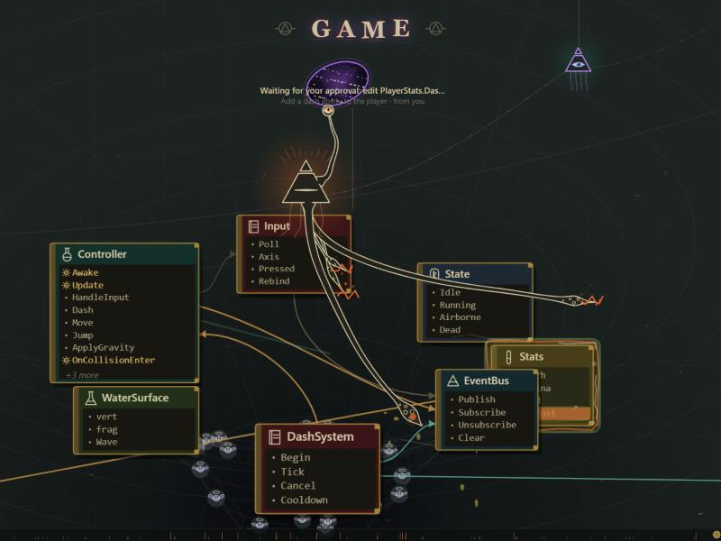

# Abyssal Eye

Something is reading your codebase. You can watch it.

Abyssal Eye is a Claude Code plugin that draws a living, Lovecraftian map of what Claude is doing in your project: every class it reads or edits surfaces as a tome, Claude itself is a pyramid with one eye, its tentacles reach into the exact method it writes, and the bindings it creates draw themselves on while you watch. Plainly: it is a visual activity monitor for Claude Code sessions, rendered on one canvas in your browser, fed by the hooks of your own sessions, running entirely on your machine.

Claude Code only (terminal, IDE and the desktop app's Code tab); it does nothing in claude.ai chat or Cowork. The in-app pane is used in the desktop app; elsewhere the view opens in your system browser.



## Install

Windows, macOS and Linux. The local server is a small Perl script: on Windows it runs in the Perl that ships with Git for Windows (which Claude Code needs anyway), on macOS in the system perl, on Linux in the perl package. In a Claude Code session:

```
/plugin marketplace add WeWatchFromTheAbyss/Abyssal-Eye
/plugin install abyssal-eye@abyssal-eye
```

Or paste this sentence into any Claude Code session and Claude installs it for you:

```
Install the Claude Code plugin "abyssal-eye" for me: run `claude plugin marketplace add WeWatchFromTheAbyss/Abyssal-Eye`, then `claude plugin install abyssal-eye@abyssal-eye --scope user`, show me the output, and tell me to restart Claude Code.
```

Pick the user scope so every project gets the view. Restart Claude Code once.

## First run

- In the desktop app a small "⛧ Abyssal Eye" button appears above the prompt. Pressing it (or running `/abyssal-eye`) sends one short message in your name, "⛧ Open the Abyssal Eye", and attaches instructions Claude reads but the chat does not show: open the view in the browser pane and close extra Abyssal Eye tabs. Claude answers with a single glyph. Because the request is yours, this works the same in default, accept-edits and auto modes, with no permission rule to add; it costs one short model turn and waits for the current turn to finish. The prompt is not shown on the map. Without a browser pane (a terminal session) the view opens in your system browser instead; `/abyssal-eye browser` always does. A second button, "↗ Open in browser", opens the view in your system browser straight away, and inside the pane the page itself shows a small ↗ control in its lower right corner that does the same.
- The status line shows the view's address, `http://localhost:7311/p/<project>/`. One view per project, fed by every Claude session working in it.
- `http://localhost:7311/` lists the projects the server knows about.
- Add `?demo` to a view's address to play a scripted demo session with no Claude involved.

Controls: the mouse wheel zooms, dragging pans, double-clicking returns to following the work. Drag the thin bar at the bottom to rewind; drag it to the right end to return to live. Right-drag (or shift-drag) tilts the view. `Q` cycles the quality, `M` cycles the motion (down to a still map). Drag a card to pin it; double-click it to release it.

## What you are looking at

- **Pyramid with an eye**: a Claude session. The eye looks at what it works on and blinks; it closes while Claude thinks. Smaller pyramids tethered to it are subagents; a finished subagent shrinks to a knot on its branch.
- **Tentacles**: edits. A tentacle reaches the method being written and electrifies the tome. Gross edits make the tome wobble and drip.
- **Eye stalks**: reading and searching. They scan the lines Claude reads. Many stalks is a wide survey.
- **Tomes**: classes and files, with their members listed; the ones Claude touched recently sit close to its vortex, the rest orbit further out. Folders are **wards**, the thin dotted arcs with a name. Quiet tomes fold to their header, then gather into **piles** labelled by what they hold; the heavy, well-connected tome of a cluster sits at its centre, slightly larger.
- **Strands between tomes**: bindings (one type referring to another). A ghostly dashed strand is a binding an edit would create, shown while the edit awaits your approval; a new binding glows when it lands; a red dashed one is being removed. Strands across folders are heavier.
- **Souls**: the context window. Each winged soul in orbit is a slice of the budget still free; as the context fills, the pyramid pulls them in and eats them. A **skull** drifting out afterwards is the detritus of that labour; it sinks slowly into the well.
- **Pentagram** under a pyramid: the turn is done, Claude waits for you.
- **An open mouth** in place of the eye: Claude needs you right now (a permission dialog, or a question it asked).
- **TheyEye** (a sphere of eyes on leathery wings): an inspector, a subagent summoned to review, verify, audit or check work. It darts between the files it reads.
- **Your own edits** to files on the map glow violet.
- **Dust** falls into the wormhole while Claude is busy; **ripples** cross the web when a tome is touched.

## Three ways to use it

1. **Watch a long task.** Give Claude a refactor and leave the view on a second monitor. You see where it is reading, where it is writing, when it is waiting on you, and when it is done, without tailing the chat.
2. **Review what an edit will bind.** When Claude proposes an edit, the strands it would create appear while the permission dialog is up. A strand crossing into a folder you did not expect is a reason to look before approving.
3. **Rewind a session.** Drag the bar at the bottom back to see what Claude touched first, how its attention moved, and which bindings came and went. Several sessions in one project share the view, each with its own pyramid.

## Supported languages

Members and bindings are extracted with lightweight parsers (no compilers): C#, C, C++, Objective-C, Java, Kotlin, Scala, Swift, Dart, PHP, Groovy, Go, Rust, TypeScript, JavaScript, Vue and Svelte single-file components, Python, Ruby, Lua, Elixir, Haskell, OCaml, F#, Elm, shell scripts, batch files, PowerShell, SQL, shader languages (HLSL, GLSL, WGSL, ShaderLab), CSS and its dialects, HTML and XML-like files, JSON, YAML, TOML, INI-style configs, Markdown, and plain text files. Binary files, lock files and build output folders are ignored.

## Troubleshooting

- **No button, no status line.** Restart Claude Code after installing. The plugin needs perl: on Windows the one inside Git for Windows (found through CLAUDE_CODE_GIT_BASH_PATH or the usual install folders), elsewhere the system perl; without it the status line says so once.
- **"could not start its server".** The server is `web/server.pl`, started as `perl server.pl --root <the plugin's web folder> --port 7311 --daemon` (on Windows with Git's `usr\bin\perl.exe`); run that line without `--daemon` to see any error. It needs one free port in 7311 to 7340.
- **The view is empty.** The map grows from Claude's work; nothing is scanned up front. Open it, then give Claude something to do. `?demo` shows what a session looks like.
- **The pane shows nothing in a hidden tab.** The page pauses its animation while hidden; bring it forward.
- **Two copies of the plugin** (for example a development copy and the installed one) will fight over a session; the second is refused by the server and goes quiet.

## What it reads, runs and sends

Everything stays on your machine. There is no telemetry. The sections below list every hook, program, network call, file and prompt of the plugin.

### Hooks

Each hook observes; none blocks, allows or rewrites what Claude or you do, with the one exception named under prompt.submit.

- **session.start**: when a session starts. Works out the project (repository root), finds perl, starts or finds the local server, replays the session's own transcript into the map, registers the `/abyssal-eye` command and starts its timers (push events every 100 ms, ping every 10 s, look for your own edits to mapped files every 4 s). Decides nothing; always lets the session start.
- **tool.call**: around every tool call of the session and its subagents. Sees the tool's name and input. For Read, Edit, Write, NotebookEdit, Grep and Glob it reads the file the call names and analyses it; for Bash it records the description and whether the command only looks; for Agent it records the description and a prompt excerpt (160 characters). It then lets the call run unchanged and records whether it failed. It never changes a call's input or result, never denies or allows a call, and never calls a tool itself.
- **turn.start**: when a turn starts. Records the first 80 characters of your prompt as the map's caption (not for the plugin's own open line) and notes that Claude is busy. Changes nothing.
- **turn.step**: around each request to the model. Records that Claude is thinking, the number of messages sent, and afterwards the context window use (tokens used and window size, from the session's own usage figures) for the souls. Passes every chunk through unread and unchanged.
- **turn.complete**: when a turn ends. Records that Claude is idle. Changes nothing.
- **classic.PermissionRequest**: when a permission dialog is shown. Records that the pending call waits on you (the open mouth). It does not answer the dialog and has no say in the decision.
- **prompt.submit**: when a prompt is submitted. It acts only on the plugin's own open line (text exactly "⛧ Open the Abyssal Eye", submitted by this plugin): it attaches the instructions quoted under Prompts as hidden context. Every other prompt passes through untouched.
- **prompt.context**: once per conversation, when the context blocks of the first message are built. Adds one block named `abyssalEye` that tells Claude what the open line means (the same instructions as under Prompts). Changes no other block.
- **command.run** (`/abyssal-eye`): opens the view (see Prompts), or with `browser` opens the system browser.
- **ui.render** (AbovePrompt): draws the "⛧ Abyssal Eye" and "↗ Open in browser" buttons, and "⬆ Update to <version>" when an update is known.

### Programs run

- **perl** `<plugin>/web/server.pl --root <plugin>/web --port 7311 --daemon`: the local server (plain readable Perl, core modules only). It serves the page and holds the event stream in memory, started once per machine, detached, with no window; it exits after 10 minutes without a session. On macOS and Linux perl is run by name. On Windows perl is not on the PATH, so the plugin looks for the `usr\bin\perl.exe` inside Git for Windows (from CLAUDE_CODE_GIT_BASH_PATH, else `C:\Program Files\Git`, `C:\Program Files (x86)\Git`, `%LOCALAPPDATA%\Programs\Git`) and runs that file; that is the only program path worked out at run time.
- **perl -v**: once at session start, to learn whether perl exists.
- **uname -s**: once at session start on macOS and Linux, to tell the two apart.
- **cmd /c start "" <view address>** (Windows), **open <view address>** (macOS), **xdg-open <view address>** (Linux): opens the view in your system browser, only when you press "↗ Open in browser", run `/abyssal-eye browser`, or the browser pane is unavailable. The address is always the plugin's own `http://localhost:<port>/p/<project>/`.
- **claude plugin marketplace update abyssal-eye** then **claude plugin update abyssal-eye@abyssal-eye**: only when you click the Update button.
- The server itself runs the same browser opener (`cmd /c start`, `open` or `xdg-open`) when you press the ↗ control inside the view; it builds the address itself from a project it already knows.

No shell is invoked and no inline script is run.

### Network

- **127.0.0.1, ports 7311 to 7340** (the local server, loopback only): the plugin sends the session's events (tool names, file paths, class and member names, counts of added and removed lines, prompt excerpts of 80 characters, context window use) to `/push`, a keep-alive to `/ping`, and reads `/hello`, `/seen` and `/pref`. The server listens on 127.0.0.1 and [::1] only, refuses peers that are not loopback, refuses requests whose Host is not localhost, 127.0.0.1 or [::1], and refuses cross-site posts. The view page talks to the same server (events, a heartbeat every 3 s with its instance id, the page version and whether it is shown, your earlier-sessions switch, and the ↗ control).
- **raw.githubusercontent.com** (only in builds whose `config.json` has `"updateCheck": true`, and never when ABYSSAL_EYE_NO_UPDATE_CHECK=1 or CLAUDE_CODE_DISABLE_NONESSENTIAL_TRAFFIC is set): one GET of `https://raw.githubusercontent.com/WeWatchFromTheAbyss/Abyssal-Eye/main/.claude-plugin/plugin.json` per session start, with no body, no cookies and no headers of the plugin's own, to compare versions. Nothing about you or your project is sent.

Nothing else is contacted.

### Files

- **Read**: the current session's transcript and its subagents' transcripts under `<Claude config folder>/projects/<project>/` (only those `.jsonl` files; nothing else in the config folder is opened); earlier transcripts of the same project (up to 25 from the last 14 days) only when you opt in with ABYSSAL_EYE_HISTORY=1 or the H key in the view; the source files Claude touches (files over about 1.5 MB are skipped), read again when they change so your own edits show; the plugin's own `config.json` and `.claude-plugin/plugin.json`.
- **Written by the plugin**: none. It writes no settings, instruction, build or start-up file, and no file of its own.
- **Written by the server**: one empty lock file, `abyssal-eye-server.lock`, in `$XDG_RUNTIME_DIR`, else `~/.cache`, else the temp folder (there named `abyssal-eye-server-<user>.lock`), so only one server runs. The event stream is kept in memory only.
- **In your browser**: the view keeps its settings (quality, motion, tilt, pinned cards, the earlier-sessions switch) in localStorage for its own address.

### Prompts submitted

One, and only when you press the "⛧ Abyssal Eye" button or run `/abyssal-eye` in the desktop app while no current view is already displayed. The visible message, sent in your name, is exactly:

```
⛧ Open the Abyssal Eye
```

The hidden context attached to it (Claude reads it, the chat does not show it) is:

```
The user pressed the Abyssal Eye button. Act immediately: do not think, plan or explain. Call <browser pane>preview_start with url http://localhost:<port>/p/<project>/?pane=1. Then call <browser pane>tabs_context and <browser pane>tabs_close on every other tab whose origin is http://localhost or http://127.0.0.1 on a port from 7311 to 7340, keeping only the tabId preview_start returned; never touch a tab of any other origin. If preview_start fails, call it once more; if it fails again reply with the one line "The pane did not open." and nothing else. Make no other tool calls. Reply with exactly the single character ⛧ and no other text.
```

The tab clean-up sentence is included only when a view is already open; when the pane's tools are not loaded yet, the first sentence asks for one ToolSearch that selects those three tools. The plugin itself never calls a tool: Claude does, in a turn you asked for. No other prompt is ever submitted, and nothing from your files or transcripts is put in a prompt.

### Credentials

None. The plugin reads no token, key, password or credentials file, and has nowhere to send one. The environment variables it reads are OS, SYSTEMROOT, LOCALAPPDATA, USERPROFILE, HOME, CLAUDE_CONFIG_DIR and CLAUDE_CODE_GIT_BASH_PATH (to find folders and perl), and its own switches ABYSSAL_EYE_HISTORY, ABYSSAL_EYE_NO_UPDATE_CHECK and CLAUDE_CODE_DISABLE_NONESSENTIAL_TRAFFIC. The context window figures come from the session's own usage call and stay on the machine.

### Reflective code

One small helper reads a named field of a tool call's input by its key (for example `file_path`, `command` or `description`), because every tool has a different input shape. The keys are fixed words in the source. There is no eval, no generated code and no dynamic import.

### Switches

- `ABYSSAL_EYE_HISTORY=1`: also seed the map from earlier sessions of the project (or press H in the view).
- `ABYSSAL_EYE_NO_UPDATE_CHECK=1`: no update check.
- `config.json` in the plugin folder, `"updateCheck": false`: no update check, no Update button, no `claude` command.
- On the page, only with `?debug` in the address: `skip=<seconds>` and `noloop` for the demo, `nopause` to keep animating in a hidden tab, `stress=<n>` for a large demo map, and `window.__scope` for the live state.

## Privacy

Everything stays on your machine: the map, the event stream and the prompt excerpts live in the memory of a loopback-only local server and in your browser; nothing is uploaded. The plugin reads your own session transcripts and the source files Claude touches, and earlier transcripts of the project only when you opt in. The only outbound request is the optional update check described above (one GET of the published manifest at session start), which can be turned off and is off in the directory build.

## Support

Questions and bug reports: https://github.com/WeWatchFromTheAbyss/Abyssal-Eye/issues

## License

MIT, see `LICENSE`.
