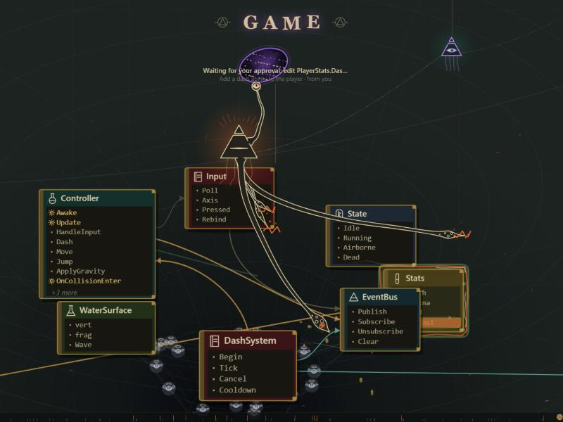

# Abyssal Eye

Something is reading your codebase. You can watch it.

Abyssal Eye is a Claude Code plugin that draws a living, Lovecraftian map of what Claude is doing in your project: every class it reads or edits surfaces as a tome, Claude itself is a pyramid with one eye, its tentacles reach into the exact method it writes, and the bindings it creates draw themselves on while you watch. Plainly: it is a visual activity monitor for Claude Code sessions, rendered on one canvas in your browser, fed by the hooks of your own sessions, running entirely on your machine.



## Install

Windows only (the local server is a PowerShell script). In a Claude Code session:

```
/plugin marketplace add WeWatchFromTheAbyss/Abyssal-Eye
/plugin install abyssal-eye@abyssal-eye
```

Pick the user scope so every project gets the view. Restart Claude Code once.

## First run

- In the desktop app a small "⛧ Abyssal Eye" button appears above the prompt. Pressing it (or running `/abyssal-eye`) submits one short prompt in the chat in your name, "⛧ Open the Abyssal Eye" (its instructions travel as hidden context), and the model opens the view in the built-in browser pane (one tab, reloaded in place if it is already open), answering with a single glyph. Because the request is yours, this works the same in default, accept-edits and auto modes, with no permission rule to add; it costs one short model turn and waits for the current turn to finish. The prompt is not shown on the map. Without a browser pane (a terminal session) the view opens in your system browser instead; `/abyssal-eye browser` always does. A second button, "↗ Open in browser", opens the view in your system browser straight away, and inside the pane the page itself shows a small ↗ control in its lower right corner that does the same.
- The status line shows the view's address, `http://localhost:7311/p/<project>/`. One view per project, fed by every Claude session working in it.
- `http://localhost:7311/` lists the projects the server knows about.
- Add `?demo` to a view's address to play a scripted demo session with no Claude involved.

Controls: the mouse wheel zooms, dragging pans, double-clicking returns to following the work. Drag the thin bar at the bottom to rewind; drag it to the right end to return to live. Right-drag (or shift-drag) tilts the view. `Q` cycles the quality, `M` cycles the motion (down to a still map). Drag a card to pin it; double-click it to release it.

## What you are looking at

- **Pyramid with an eye**: a Claude session. The eye looks at what it works on and blinks; it closes while Claude thinks. Smaller pyramids tethered to it are subagents; a finished subagent shrinks to a knot on its branch.
- **Tentacles**: edits. A tentacle reaches the method being written and electrifies the tome. Gross edits make the tome wobble and drip.
- **Eye stalks**: reading and searching. They scan the lines Claude reads. Many stalks is a wide survey.
- **Tomes**: classes and files, with their members listed; the ones Claude touched recently sit close to its vortex, the rest orbit further out. Folders are **wards**, the thin dotted arcs with a name. Quiet tomes fold to their header, then gather into **piles** labelled by what they hold; the heavy, well-connected tome of a cluster sits at its centre, slightly larger.
- **Strands between tomes**: bindings (one type referring to another). A ghostly dashed strand is a binding an edit would create, shown while the edit awaits your approval; a new binding glows when it lands; a red dashed one is being removed. Strands across folders are heavier.
- **Souls**: the context window. Each winged soul in orbit is a slice of the budget still free; as the context fills, the pyramid pulls them in and eats them. A **skull** drifting out afterwards is the detritus of that labour; it sinks slowly into the well.
- **Pentagram** under a pyramid: the turn is done, Claude waits for you.
- **An open mouth** in place of the eye: Claude needs you right now (a permission dialog, or a question it asked).
- **TheyEye** (a sphere of eyes on leathery wings): an inspector, a subagent summoned to review, verify, audit or check work. It darts between the files it reads.
- **Your own edits** to files on the map glow violet.
- **Dust** falls into the wormhole while Claude is busy; **ripples** cross the web when a tome is touched.

## Three ways to use it

1. **Watch a long task.** Give Claude a refactor and leave the view on a second monitor. You see where it is reading, where it is writing, when it is waiting on you, and when it is done, without tailing the chat.
2. **Review what an edit will bind.** When Claude proposes an edit, the strands it would create appear while the permission dialog is up. A strand crossing into a folder you did not expect is a reason to look before approving.
3. **Rewind a session.** Drag the bar at the bottom back to see what Claude touched first, how its attention moved, and which bindings came and went. Several sessions in one project share the view, each with its own pyramid.

## Supported languages

Members and bindings are extracted with lightweight parsers (no compilers): C#, C, C++, Objective-C, Java, Kotlin, Scala, Swift, Dart, PHP, Groovy, Go, Rust, TypeScript, JavaScript, Vue and Svelte single-file components, Python, Ruby, Lua, Elixir, Haskell, OCaml, F#, Elm, shell scripts, batch files, PowerShell, SQL, shader languages (HLSL, GLSL, WGSL, ShaderLab), CSS and its dialects, HTML and XML-like files, JSON, YAML, TOML, INI-style configs, Markdown, and plain text files. Binary files, lock files and build output folders are ignored.

## Troubleshooting

- **No button, no status line.** The plugin only runs on Windows; elsewhere the status line says so once. Restart Claude Code after installing.
- **"could not start its server".** The server is `web/server.ps1`, started hidden with `powershell -ExecutionPolicy Bypass`. Run it by hand from the plugin's `web` folder with `-Root <that folder>` to see any error. It needs one free port in 7311 to 7340.
- **The view is empty.** The map grows from Claude's work; nothing is scanned up front. Open it, then give Claude something to do. `?demo` shows what a session looks like.
- **The pane shows nothing in a hidden tab.** The page pauses its animation while hidden; bring it forward.
- **Two copies of the plugin** (for example a development copy and the installed one) will fight over a session; the second is refused by the server and goes quiet.

## What it reads, runs and sends

Everything stays on your machine. There is no telemetry and nothing leaves the computer.

- **Reads**: the transcript of the current session and of its subagents (from the Claude Code projects folder), plus up to 25 earlier transcripts of the same project from the last 14 days, to seed the map with what was touched before. The source files Claude touches are read and analysed (files over about 1.5 MB are skipped) and polled every 4 seconds afterwards so your own edits show up. Prompt excerpts (the first 200 characters) are kept in the local server's memory as part of the event stream, and so are file paths, class and member names.
- **Runs**: a hidden PowerShell process (`web/server.ps1`, started with `-ExecutionPolicy Bypass`) that serves the page and holds the event stream in memory. It stays up while sessions talk to it and exits after 10 minutes of silence. It never writes to disk.
- **Listens**: HTTP on loopback only, 127.0.0.1 and [::1], one port in 7311 to 7340. Requests from other machines are refused, and so are cross-site posts from web pages. One exception: the view page itself may POST /open-external (same origin only), which makes the server open the view in your system browser with Start-Process; the address is built by the server from a known project key, never taken from the request. The page also sends a heartbeat every 3 s, POST /seen (same origin only: its instance id, the page version it loaded and whether it is shown), and the plugin reads GET /seen before it asks for the view to be opened, so it can tell whether a live, current, displayed view already exists; the server keeps only the last few seconds of these, in memory.
- **Sends**: nothing anywhere but to that loopback server.

Debug switches on the page (only with `?debug` in the address): `skip=<seconds>` and `noloop` for the demo, `nopause` to keep animating in a hidden tab, `stress=<n>` for a large demo map, and `window.__scope` for the live state.

## License

MIT, see `LICENSE`.
